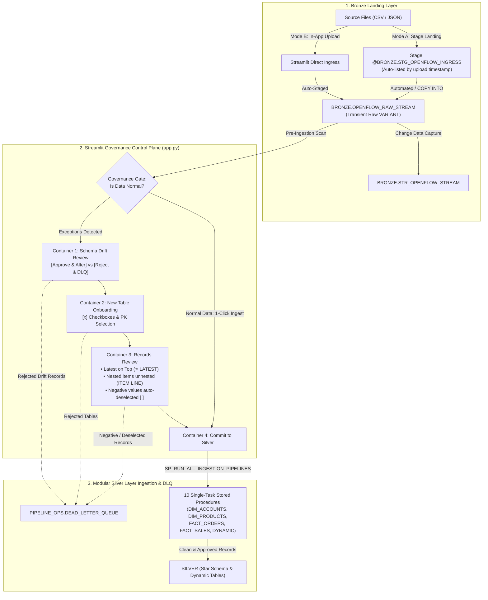

# Design Document: Event-Driven Retail Data Integration Framework

---

## 1. Document Overview

| Attribute | Details |
| :--- | :--- |
| **Framework Name** | Event-Driven Retail Data Integration Framework |
| **Target System** | Snowflake Cloud Data Platform |
| **Architecture Pattern** | Medallion Layer (Bronze → Silver) with Star Schema & CDC |

---

## 2. Business Purpose & Scope

### 2.1 Business Problem
Organizations face high cloud costs, rigid batch schedules, and fragile ETL pipelines where a single bad record crashes downstream reporting and customer data privacy is exposed.

### 2.2 Solution Objectives
* **Event-Driven & FinOps Aware**: Compute warehouses run only when new data lands, spending zero credits when idle.
* **Resilient Data Quality**: Corrupted rows are isolated into a Dead Letter Queue (DLQ) without halting the pipeline.
* **Governed Dimensional Modeling**: Raw JSON is modeled into clean Star Schema Dimensions and Facts with Primary/Foreign Key relations.
* **Regulatory Privacy**: Customer PII is dynamically masked for business analysts.

---

## 3. End-to-End Architecture



### 3.1 Key Snowflake Native Features & Impact on Code

| Snowflake Native Feature | What It Does | How It Impacts Our Code / Pipeline |
| :--- | :--- | :--- |
| **`LATERAL FLATTEN`** | Explodes nested JSON arrays or sub-objects into individual relational rows. | Unpacks nested line items (`RAW_RECORD:items`) directly in SQL, normalizing multi-item order baskets into `SILVER.FACT_SALES` without external processing loops. |
| **Snowflake Streams (CDC)** | Tracks row-level DML delta inserts and advances offset bookmarks as records are consumed. | Powers incremental ingestion on `BRONZE.OPENFLOW_RAW_STREAM`; stored procedures process only fresh delta rows instead of scanning the full history. |
| **Snowflake Tasks (`SYSTEM$STREAM_HAS_DATA`)** | Schedules automated execution and evaluates stream activity before triggering warehouse wake-up. | Automates `TASK_RUN_OPENFLOW_PIPELINES` every 5 minutes while enforcing FinOps controls by preventing warehouse spin-up when no new data has landed. |
| **Semi-Structured `VARIANT` & Path Navigation** | Stores schema-less JSON natively with colon path extraction (`RAW_RECORD:col::TYPE`). | Enables raw JSON to land directly in Bronze with zero upfront DDL; allows ingestion procedures to cast and validate fields dynamically at runtime. |
| **Information Schema Catalog (`INFORMATION_SCHEMA.COLUMNS`)** | Exposes real-time table structures, column definitions, and data types via system views. | Powers dynamic schema drift evolution; procedures query the catalog at runtime to dynamically project and merge newly added columns (`INDUSTRY`, `REGION`). |
| **Dynamic Data Masking (`MASKING POLICY`)** | Intercepts queries at runtime and selectively masks column values based on the executing role. | Protects customer PII (`ACCOUNT_NAME`) for `ROLE_ANALYST` (`"Ap**** (Masked)"`) at the database engine level without duplicating data or creating separate views. |

---

## 4. Simplified Data Modeling (Core Tables + Dynamic Future Tables)

### 4.1 Schema Breakdown

| Schema | Purpose | Retention | Key Objects |
| :--- | :--- | :--- | :--- |
| **`BRONZE`** | Raw file staging and initial table landing. | 1 Day (Transient) | Stage `STG_OPENFLOW_INGRESS`, Table `OPENFLOW_RAW_STREAM`, Stream `STR_OPENFLOW_STREAM`. |
| **`SILVER`** | Star Schema Dimensions, Facts, and dynamic onboarded tables. | 7 Days (Time Travel) | **Core Tables**: `DIM_ACCOUNTS`, `DIM_PRODUCTS`, `FACT_ORDERS`, `FACT_SALES`<br>**Dynamic / Future Tables**: `SUPPLIER`, `WAREHOUSE`, `SHIPMENT`. |
| **`PIPELINE_OPS`** | Pipeline control plane, metadata governance, review queues, observability, and error isolation. | Standard | Tables: `SOURCE_INGESTION_CONTROL`, `SCHEMA_EVOLUTION_CONTROL`, `DEAD_LETTER_QUEUE`, `SCHEMA_DRIFT_LOG`, `PENDING_NEW_TABLE_COLUMNS`, `SCHEMA_DRIFT_APPROVAL_QUEUE`, `WATERMARKS`, `PIPELINE_METRICS`. |

### 4.2 Star Schema Data Model (Core Tables + Dynamic Future Tables)


### 4.3 Control Plane Data Model (Pipeline Operations)

```mermaid
erDiagram

    %% =========================================================================
    %% RELATIONSHIPS
    %% =========================================================================
    SOURCE_INGESTION_CONTROL ||--o{ DEAD_LETTER_QUEUE : isolates_to
    SOURCE_INGESTION_CONTROL ||--o{ SCHEMA_DRIFT_LOG : logs_to
    SOURCE_INGESTION_CONTROL ||--o{ WATERMARKS : tracks
    SOURCE_INGESTION_CONTROL ||--o{ PIPELINE_METRICS : records_runs_in
    SOURCE_INGESTION_CONTROL ||--o{ SCHEMA_EVOLUTION_CONTROL : specifies_policy
    SCHEMA_DRIFT_APPROVAL_QUEUE ||--o{ SCHEMA_DRIFT_LOG : logs_decision
    SCHEMA_DRIFT_APPROVAL_QUEUE ||--o{ DEAD_LETTER_QUEUE : rejects_to
    PENDING_NEW_TABLE_COLUMNS ||--o{ SOURCE_INGESTION_CONTROL : registers_into
    PENDING_NEW_TABLE_COLUMNS ||--o{ DEAD_LETTER_QUEUE : rejects_to
    PIPELINE_METRICS ||--o{ V_MONITORING_DASHBOARD : visualizes

    %% =========================================================================
    %% ENTITY DEFINITIONS WITH COMMENTS
    %% =========================================================================
    SOURCE_INGESTION_CONTROL {
        NUMBER SOURCE_ID PK "Auto-incrementing primary key for source catalog"
        VARCHAR SOURCE_NAME "Logical system identifier (SALESFORCE_CRM, ERP_CATALOG, ORDER_SERVICE, POS_CHECKOUT)"
        VARCHAR PAYLOAD_TYPE "Incoming JSON entity discriminator (ACCOUNT, PRODUCT, ORDER, SALE, SUPPLIER, WAREHOUSE)"
        VARCHAR TARGET_SCHEMA "Target destination schema in Snowflake (SILVER)"
        VARCHAR TARGET_TABLE "Target destination table name in Snowflake"
        VARCHAR BUSINESS_KEY "Primary key column name used for deduplication and merges"
        VARCHAR TIE_BREAKER_COL "Timestamp column name for latest version resolution (UPDATED_AT, SALE_TIME)"
        VARCHAR SCHEMA_DRIFT_ACTION "Default schema evolution policy when unmapped column arrives (ADD or ALERT)"
        BOOLEAN AUTO_CREATE_TABLE "Flag enabling dynamic table provisioning"
        VARCHAR APPROVAL_STATUS "Governance state (APPROVED, PENDING_REVIEW)"
        VARCHAR FLATTEN_POLICY "Array flattening strategy (LATEST_ONLY, ALL_ELEMENTS)"
        BOOLEAN IS_ACTIVE "Flag controlling whether pipeline execution is active"
        TIMESTAMP_NTZ CREATED_AT "Configuration creation timestamp"
        TIMESTAMP_NTZ UPDATED_AT "Configuration last update timestamp"
    }

    SCHEMA_EVOLUTION_CONTROL {
        VARCHAR PIPELINE_NAME PK "Entity or pipeline discriminator (ACCOUNT, PRODUCT, ORDER, SALE)"
        VARCHAR TARGET_SCHEMA "Target destination schema (SILVER)"
        VARCHAR TARGET_TABLE "Target destination table name"
        VARCHAR SCHEMA_DRIFT_ACTION "Configured drift policy (ADD: auto-alter table, ALERT: quarantine to DLQ)"
        BOOLEAN IS_ACTIVE "Flag indicating if evolution policy is active"
        TIMESTAMP_NTZ UPDATED_AT "Policy last update timestamp"
    }

    DEAD_LETTER_QUEUE {
        NUMBER ERROR_ID PK "Auto-incrementing primary key sequence for DLQ entries"
        VARCHAR PIPELINE_NAME "Pipeline or payload type identifier where error originated"
        VARIANT RAW_PAYLOAD "Full unparsed raw JSON record causing failure, drift rejection, or validation error"
        VARCHAR ERROR_MSG "Detailed error reason, validation failure, or drift quarantine note"
        NUMBER RETRY_COUNT "Current execution retry counter (max 3 attempts)"
        VARCHAR STATUS "Processing state of quarantined record (QUEUED, REJECTED_DRIFT, REJECTED_NEW_TABLE, SUCCESS, EXHAUSTED)"
        TIMESTAMP_NTZ LOGGED_AT "Timestamp record was routed to Dead Letter Queue"
    }

    SCHEMA_DRIFT_LOG {
        NUMBER LOG_ID PK "Auto-incrementing primary key sequence for drift audit log"
        VARCHAR PIPELINE_NAME "Source pipeline or entity experiencing schema drift"
        VARCHAR TARGET_TABLE "Target table where schema drift was detected or applied"
        VARCHAR DETECTED_COLUMN "Name of incoming column missing from target table catalog"
        VARCHAR DRIFT_ACTION "Governance action applied (ADD, ALERT, MANUAL_APPROVE, MANUAL_REJECT, AUTO_ONBOARD)"
        VARCHAR EXECUTION_STATUS "Execution outcome (ALTER_SUCCESS, QUARANTINED_TO_DLQ, TABLE_CREATED)"
        VARCHAR MESSAGE "Human-readable descriptive audit message"
        TIMESTAMP_NTZ LOGGED_AT "Timestamp drift event was evaluated and logged"
    }

    PENDING_NEW_TABLE_COLUMNS {
        NUMBER DISCOVERY_ID PK "Auto-incrementing primary key sequence for discovered entity columns"
        VARCHAR PAYLOAD_TYPE "Incoming unrecognized payload entity type (e.g. SUPPLIER, WAREHOUSE, SHIPMENT)"
        VARCHAR SUGGESTED_TABLE_NAME "Suggested Silver destination table name"
        VARCHAR COLUMN_NAME "Discovered JSON field name"
        VARCHAR INFERRED_DATA_TYPE "Inferred Snowflake SQL data type (VARCHAR, INT, NUMBER, BOOLEAN, TIMESTAMP_NTZ)"
        BOOLEAN IS_PRIMARY_KEY_CANDIDATE "Flag indicating whether column ends in _ID and qualifies as Primary Key"
        BOOLEAN IS_SELECTED "Interactive selection flag from Streamlit UI ([x] Include?)"
        VARCHAR SAMPLE_VALUE "Sample value observed in ingress batch for human validation"
        TIMESTAMP_NTZ DISCOVERED_AT "Timestamp entity was detected by SP_DETECT_PENDING_APPROVALS"
        VARCHAR STATUS "Review state (PENDING_REVIEW, APPROVED, REJECTED)"
    }

    SCHEMA_DRIFT_APPROVAL_QUEUE {
        NUMBER QUEUE_ID PK "Auto-incrementing primary key sequence for drift approval items"
        VARCHAR PAYLOAD_TYPE "Entity experiencing drift (e.g. ACCOUNT, ORDER)"
        VARCHAR TARGET_SCHEMA "Target schema in Snowflake (SILVER)"
        VARCHAR TARGET_TABLE "Target table name (DIM_ACCOUNTS, FACT_ORDERS)"
        VARCHAR DETECTED_COLUMN "Discovered unmapped column name (e.g. INDUSTRY, REGION)"
        VARCHAR INFERRED_DATA_TYPE "Inferred Snowflake SQL data type for dynamic ALTER TABLE"
        VARCHAR SAMPLE_VALUE "Sample value observed in batch payload"
        VARCHAR DEFAULT_POLICY_ACTION "Default action configured in policy (ADD or ALERT)"
        VARCHAR STATUS "Review status (PENDING_REVIEW, APPROVED, REJECTED)"
        VARCHAR REVIEWED_BY "User or role executing the governance decision"
        TIMESTAMP_NTZ REVIEWED_AT "Timestamp governance decision was executed"
        TIMESTAMP_NTZ CREATED_AT "Timestamp drift was queued for review"
    }

    WATERMARKS {
        VARCHAR PIPELINE_NAME PK "Unique pipeline identifier for high-watermark progression (e.g. ORDER)"
        TIMESTAMP_NTZ LAST_WATERMARK "Latest maximum timestamp processed during pipeline runs"
    }

    PIPELINE_METRICS {
        VARCHAR PIPELINE_NAME "Pipeline or entity identifier (ACCOUNT, PRODUCT, ORDER, SALE, DYNAMIC)"
        VARCHAR SOURCE "Source origin system identifier (SALESFORCE_CRM, ERP_CATALOG, etc.)"
        TIMESTAMP_NTZ LAST_RUN "Timestamp pipeline execution finished"
        NUMBER SUCCESS_RECORDS "Count of records successfully merged into Silver"
        NUMBER FAILED_RECORDS "Count of records quarantined to DLQ"
        NUMBER THROUGHPUT_REC_SEC "Calculated throughput rate in records per second"
        VARCHAR FLATTENING_MODE "Array handling strategy applied (DIRECT, DYNAMIC_FLATTEN_APPLIED, LATEST_ONLY)"
    }

    V_MONITORING_DASHBOARD {
        VARCHAR Pipeline_Name "Pipeline identifier"
        VARCHAR Source "Source system"
        TIMESTAMP_NTZ Last_Run "Execution timestamp"
        NUMBER Success_Pct "Computed success percentage (Success / Total * 100)"
        NUMBER Failed_Records "Total records routed to DLQ"
        NUMBER Throughput "Throughput in records per second"
        VARCHAR Flatten_Mode "Flattening mode used"
        VARCHAR Health_Status "Visual operational indicator (🟢 HEALTHY, 🟡 WARNING, 🔴 CRITICAL)"
    }
```



---

## 5. Code Plane & Execution Logic

The production data integration architecture replaces monolithic, brittle SQL scripts with a **modular, single-task stored procedure architecture** orchestrated through a unified master runner ([`openflow_governance_procedures.sql`](file:///c:/Users/NitheeshPadarthi/OneDrive%20-%20Mastech%20Digital/Snowflake/Training/openflow_governance_procedures.sql) / [`Data_integrarion.sql`](file:///c:/Users/NitheeshPadarthi/OneDrive%20-%20Mastech%20Digital/Snowflake/Training/Data_integrarion.sql)) and an interactive Streamlit governance control plane ([`app.py`](file:///c:/Users/NitheeshPadarthi/OneDrive%20-%20Mastech%20Digital/Snowflake/Training/app.py)).

### 5.1 Architecture Overview & Ingestion Flow

The pipeline executes in three synchronized stages:

1. **Pre-Ingestion Discovery & Governance Plane**:
   - Analyzes incoming stream data against existing schema catalogs.
   - Detects brand-new entities or unmapped columns and registers them in review staging queues.
   - Executes dynamic DDL (table creation or table alteration) based on human approval or autonomous policy.
2. **Execution Plane (Modular Single-Task Ingestion)**:
   - Evaluates JSON schema contracts (null PK checks, negative value validation).
   - Ingests core dimensions, core facts, and registered dynamic tables via independent, isolated stored procedures.
   - Guarantees idempotent SCD Type 1 `MERGE` behavior and cross-union deduplication.
3. **Observability, Quarantine & finOps Plane**:
   - Routes schema violations and corrupt records to `PIPELINE_OPS.DEAD_LETTER_QUEUE` while preserving raw Bronze history.
   - Logs throughput, run times, and record counts into `PIPELINE_OPS.PIPELINE_METRICS`.
   - Exposes operational health via `PIPELINE_OPS.V_MONITORING_DASHBOARD` and gates execution via Snowflake Tasks.

```
┌─────────────────────────────────────────────────────────────────────────────────────────────┐
│ 1. STREAM INGRESS                                                                           │
│    BRONZE.OPENFLOW_RAW_STREAM ──▶ BRONZE.STR_OPENFLOW_STREAM                                 │
└───────────────────────────────────────────────┬─────────────────────────────────────────────┘
                                                │
                                                ▼
┌─────────────────────────────────────────────────────────────────────────────────────────────┐
│ 2. DISCOVERY & GOVERNANCE PROCEDURES                                                        │
│    • SP_DETECT_PENDING_APPROVALS()                                                          │
│      ├── New Tables ──▶ PIPELINE_OPS.PENDING_NEW_TABLE_COLUMNS                              │
│      └── Drift Cols ──▶ PIPELINE_OPS.SCHEMA_DRIFT_APPROVAL_QUEUE                            │
│                                                                                             │
│    [ Interactive Governance via Streamlit app.py OR Policy Automation ]                     │
│      ├── SP_CREATE_CUSTOM_ONBOARDED_TABLE()  ──▶ CREATE TABLE SILVER.<NEW_TABLE>            │
│      ├── SP_REJECT_NEW_TABLE_TO_DLQ()        ──▶ DEAD_LETTER_QUEUE ('REJECTED_NEW_TABLE')   │
│      ├── SP_APPROVE_SCHEMA_DRIFT()           ──▶ ALTER TABLE ADD COLUMN                     │
│      └── SP_REJECT_SCHEMA_DRIFT_TO_DLQ()     ──▶ DEAD_LETTER_QUEUE ('REJECTED_DRIFT')       │
└───────────────────────────────────────────────┬─────────────────────────────────────────────┘
                                                │
                                                ▼
┌─────────────────────────────────────────────────────────────────────────────────────────────┐
│ 3. MODULAR EXECUTION RUNNER: SP_RUN_ALL_INGESTION_PIPELINES(FLATTEN_POLICY)                 │
│      ├── 1. SP_INGEST_DIM_ACCOUNTS()         ──▶ Dynamic Schema Evolution MERGE (Accounts) │
│      ├── 2. SP_INGEST_DIM_PRODUCTS()         ──▶ SCD Type 1 Catalog MERGE (Products)        │
│      ├── 3. SP_INGEST_FACT_ORDERS()          ──▶ Filter Negative Keys & Watermark (Orders)  │
│      ├── 4. SP_INGEST_FACT_SALES()           ──▶ Array Flatten & Global Deduplication (Sales)│
│      └── 5. SP_INGEST_DYNAMIC_TABLE(TYPE)    ──▶ Dynamic Projection MERGE (Custom Tables)  │
└───────────────────────────────────────────────┬─────────────────────────────────────────────┘
                                                │
                                                ▼
┌─────────────────────────────────────────────────────────────────────────────────────────────┐
│ 4. OBSERVABILITY & QUALITY POSTING                                                          │
│    • Success Records ──────────────────────▶ SILVER Schema (Star Schema + Custom Tables)    │
│    • Anomalies / Corrupt / Rejected Records▶ PIPELINE_OPS.DEAD_LETTER_QUEUE                 │
│    • Run Execution Metrics ────────────────▶ PIPELINE_OPS.PIPELINE_METRICS                  │
│    • Live Health Dashboard ────────────────▶ PIPELINE_OPS.V_MONITORING_DASHBOARD (🟢🟡🔴)    │
└─────────────────────────────────────────────────────────────────────────────────────────────┘
```

---

### 5.2 Discovery & Governance Procedures (Pre-Ingestion Review Plane)

#### 1. `SP_DETECT_PENDING_APPROVALS()`
* **Purpose**: Scans incoming unprocessed records in `BRONZE.STR_OPENFLOW_STREAM` to discover:
  1. Unregistered entity payload types (e.g. `SUPPLIER`, `WAREHOUSE`, `SHIPMENT`).
  2. Unmapped attributes arriving on existing registered tables (schema drift, e.g. `INDUSTRY`, `REGION`).
* **Execution Flow**:
  - Compares incoming `PAYLOAD_TYPE` values against `PIPELINE_OPS.SOURCE_INGESTION_CONTROL`.
  - For unrecognized tables, infers column names, data types, and marks primary key candidates (`*_ID`), populating `PIPELINE_OPS.PENDING_NEW_TABLE_COLUMNS` with status `'PENDING_REVIEW'`.
  - For registered tables, compares JSON keys against `INFORMATION_SCHEMA.COLUMNS`. Missing columns are inserted into `PIPELINE_OPS.SCHEMA_DRIFT_APPROVAL_QUEUE` with their inferred SQL type.

#### 2. `SP_CREATE_CUSTOM_ONBOARDED_TABLE(payload_type, target_table, pk_col, columns_json)`
* **Purpose**: Onboards new dynamic business entities with user-selected columns.
* **Execution Flow**:
  - Parses `columns_json` provided from Streamlit Container 2 review.
  - Dynamically builds and executes:
    `CREATE TABLE IF NOT EXISTS SILVER.<TARGET_TABLE> (<SELECTED_COLUMNS>, ETL_LOADED_AT TIMESTAMP_NTZ DEFAULT CURRENT_TIMESTAMP());`
  - Registers the new pipeline in `PIPELINE_OPS.SOURCE_INGESTION_CONTROL` (`APPROVAL_STATUS = 'APPROVED'`, `AUTO_CREATE_TABLE = FALSE`, `BUSINESS_KEY = pk_col`).
  - Updates `PIPELINE_OPS.PENDING_NEW_TABLE_COLUMNS` to `'APPROVED'`.
  - Emits audit log entry `'TABLE_CREATED'` into `PIPELINE_OPS.SCHEMA_DRIFT_LOG`.

#### 3. `SP_REJECT_NEW_TABLE_TO_DLQ(payload_type, user)`
* **Purpose**: Quarantines records of an unapproved new entity.
* **Execution Flow**:
  - Extracts all records for `PAYLOAD_TYPE` from `BRONZE.STR_OPENFLOW_STREAM`.
  - Inserts them directly into `PIPELINE_OPS.DEAD_LETTER_QUEUE` with `ERROR_MSG = 'Table onboarding rejected by reviewer: <user>'` and `STATUS = 'REJECTED_NEW_TABLE'`.
  - Updates `PIPELINE_OPS.PENDING_NEW_TABLE_COLUMNS` to `'REJECTED'`.
  - Emits audit log to `PIPELINE_OPS.SCHEMA_DRIFT_LOG`. Bronze raw data remains completely untouched.

#### 4. `SP_APPROVE_SCHEMA_DRIFT(queue_id, user)`
* **Purpose**: Evolves existing table schemas when an unmapped column is approved.
* **Execution Flow**:
  - Retrieves `TARGET_SCHEMA`, `TARGET_TABLE`, `DETECTED_COLUMN`, and `INFERRED_DATA_TYPE` from `PIPELINE_OPS.SCHEMA_DRIFT_APPROVAL_QUEUE`.
  - Dynamically executes:
    `ALTER TABLE <TARGET_SCHEMA>.<TARGET_TABLE> ADD COLUMN IF NOT EXISTS <DETECTED_COLUMN> <INFERRED_DATA_TYPE>;`
  - Marks queue status `'APPROVED'`, recording `REVIEWED_BY = user` and `REVIEWED_AT = CURRENT_TIMESTAMP()`.
  - Emits audit log `'ALTER_SUCCESS'` to `PIPELINE_OPS.SCHEMA_DRIFT_LOG`.

#### 5. `SP_REJECT_SCHEMA_DRIFT_TO_DLQ(queue_id, user)`
* **Purpose**: Quarantines records attempting to introduce unauthorized columns.
* **Execution Flow**:
  - Retrieves `PAYLOAD_TYPE` and `DETECTED_COLUMN` from queue.
  - Identifies records in stream where `RAW_RECORD:<DETECTED_COLUMN> IS NOT NULL`.
  - Inserts matching records into `PIPELINE_OPS.DEAD_LETTER_QUEUE` with `ERROR_MSG = 'Schema drift column <col> rejected by reviewer: <user>'` and `STATUS = 'REJECTED_DRIFT'`.
  - Marks queue status `'REJECTED'` and logs event in `PIPELINE_OPS.SCHEMA_DRIFT_LOG`.

---

### 5.3 Core & Dynamic Ingestion Procedures (Execution Plane)

#### 6. `SP_INGEST_DIM_ACCOUNTS()`
* **Purpose**: Ingests customer account master data with dynamic schema evolution.
* **Key Mechanisms**:
  - **Dynamic Schema Reflection**: Queries `INFORMATION_SCHEMA.COLUMNS` at runtime for table `DIM_ACCOUNTS` and dynamically constructs `SELECT` expressions for all approved drifted columns (e.g. `INDUSTRY`, `REGION`) instead of hardcoded column lists.
  - **Drift Exclusion**: Joins against `PIPELINE_OPS.SCHEMA_DRIFT_APPROVAL_QUEUE` to filter out records carrying rejected drift columns.
  - **SCD Type 1 MERGE**:
    ```sql
    MERGE INTO SILVER.DIM_ACCOUNTS tgt
    USING (...) src ON tgt.ACCOUNT_ID = src.ACCOUNT_ID
    WHEN MATCHED AND src.UPDATED_AT >= tgt.UPDATED_AT THEN UPDATE SET ...
    WHEN NOT MATCHED THEN INSERT (...) VALUES (...);
    ```
  - Tracks success/failure counts and logs execution into `PIPELINE_OPS.PIPELINE_METRICS`.

#### 7. `SP_INGEST_DIM_PRODUCTS()`
* **Purpose**: Ingests product catalog dimensions.
* **Key Mechanisms**:
  - Deduplicates by `PRODUCT_ID` selecting latest `UPDATED_AT`.
  - Casts unit prices, categories, and supplier references.
  - Executes SCD Type 1 `MERGE INTO SILVER.DIM_PRODUCTS`.
  - Logs execution metrics into `PIPELINE_OPS.PIPELINE_METRICS`.

#### 8. `SP_INGEST_FACT_ORDERS()`
* **Purpose**: Ingests order header transactions and updates pipeline high watermarks.
* **Key Mechanisms**:
  - **Quality Rule & JSON Contract**: Filters out corrupt records (`ORDER_ID <= 0` or `CUSTOMER_ID IS NULL`). Violations are routed to DLQ.
  - **Dynamic Schema Evolution**: Uses `INFORMATION_SCHEMA.COLUMNS` to reflect any newly evolved order attributes.
  - **Watermark Tracking**: Captures `MAX(ORDER_TIMESTAMP)` and updates `PIPELINE_OPS.WATERMARKS` for pipeline `'ORDER'`.
  - Executes SCD Type 1 `MERGE INTO SILVER.FACT_ORDERS`.
  - Logs execution metrics into `PIPELINE_OPS.PIPELINE_METRICS`.

#### 9. `SP_INGEST_FACT_SALES(flatten_policy)`
* **Purpose**: Ingests transaction line items, handling nested arrays and resolving multi-item order baskets.
* **Key Mechanisms**:
  - **Nested Array Unnesting**: Inspects stream records for nested line items (`IS_ARRAY(RAW_RECORD:items)`). Applies `LATERAL FLATTEN(input => RAW_RECORD:items)` to unpack child elements.
  - **Dual Ingestion Harmonization**: Handles both pre-flattened POS sales payloads (`PAYLOAD_TYPE = 'SALE'`) and nested e-commerce orders (`PAYLOAD_TYPE = 'ORDER'`).
  - **Global `SALE_ID` Deduplication**: Prevents Snowflake Error 100090 (`Duplicate row detected during DML action`) by wrapping all candidate records inside a unified CTE (`WITH combined_sales AS (...)`) and partitioning by `SALE_ID ORDER BY SALE_TIMESTAMP DESC` with `ROW_NUMBER() = 1`.
  - Executes SCD Type 1 `MERGE INTO SILVER.FACT_SALES`.
  - Logs metrics with mode `'DYNAMIC_FLATTEN_APPLIED'` or `'DIRECT'` in `PIPELINE_OPS.PIPELINE_METRICS`.

#### 10. `SP_INGEST_DYNAMIC_TABLE(payload_type)`
* **Purpose**: Generic ingestion engine for dynamically onboarded custom entities (`SUPPLIER`, `WAREHOUSE`, `SHIPMENT`).
* **Key Mechanisms**:
  - Retrieves target table name, business key, and tie-breaker column from `PIPELINE_OPS.SOURCE_INGESTION_CONTROL`.
  - Queries `INFORMATION_SCHEMA.COLUMNS` to extract the exact list of user-approved columns for `SILVER.<TARGET_TABLE>`.
  - Dynamically synthesizes the projection query:
    `SELECT RAW_RECORD:<COL>::<DATA_TYPE> AS <COL>, ... FROM BRONZE.STR_OPENFLOW_STREAM WHERE PAYLOAD_TYPE = '<PAYLOAD_TYPE>'`
  - Constructs and executes dynamic SCD Type 1 `MERGE INTO SILVER.<TARGET_TABLE>` using the entity's configured business key.
  - Emits execution metrics into `PIPELINE_OPS.PIPELINE_METRICS`.

#### 11. `SP_RUN_ALL_INGESTION_PIPELINES(flatten_policy)` (Master Orchestrator)
* **Purpose**: Central coordinator invoked by Snowflake Tasks and Streamlit Container 4 commit button.
* **Execution Flow**:
  1. Calls `SP_INGEST_DIM_ACCOUNTS()`.
  2. Calls `SP_INGEST_DIM_PRODUCTS()`.
  3. Calls `SP_INGEST_FACT_ORDERS()`.
  4. Calls `SP_INGEST_FACT_SALES(flatten_policy)`.
  5. Iterates through all active onboarded dynamic tables in `PIPELINE_OPS.SOURCE_INGESTION_CONTROL` where `PAYLOAD_TYPE NOT IN ('ACCOUNT','PRODUCT','ORDER','SALE')` and invokes `SP_INGEST_DYNAMIC_TABLE(PAYLOAD_TYPE)` for each.
  6. Returns a consolidated JSON execution summary with total ingress, processed rows, and failed rows.

---

### 5.4 Automated CDC Task Scheduling

Continuous scheduled processing is managed by Snowflake Tasks:

```sql
CREATE OR REPLACE TASK PIPELINE_OPS.TASK_RUN_OPENFLOW_PIPELINES
    WAREHOUSE = 'WH_PROD'
    SCHEDULE = '5 MINUTE'
    WHEN SYSTEM$STREAM_HAS_DATA('BRONZE.STR_OPENFLOW_STREAM')
AS
    CALL PIPELINE_OPS.SP_RUN_ALL_INGESTION_PIPELINES('LATEST_ONLY');
```

* **FinOps Optimization**: The task condition `WHEN SYSTEM$STREAM_HAS_DATA(...)` ensures warehouse `WH_PROD` is never spun up if no new data has landed, preventing warehouse idle consumption.

---

### 5.5 Quality Validation, Schema Contract Rules & Dead Letter Queue (DLQ)

#### JSON Schema Validation Rules
The ingestion plane enforces explicit data quality rules before merging into Silver:
1. **Primary Key Integrity**: Payloads with missing or null business keys (`ACCOUNT_ID`, `PRODUCT_ID`, `ORDER_ID`, `SALE_ID`) are automatically rejected.
2. **Value Domain Constraints**:
   - `ORDER_ID > 0`: Negative dummy keys (e.g. `order_id = -99`) are quarantined.
   - `NET_REVENUE >= 0` and `UNIT_PRICE >= 0`: Negative pricing/revenue anomalies are flagged.
   - Required non-null relationship keys: `CUSTOMER_ID IS NOT NULL`.

#### DLQ Lifecycle & Non-Destructive Invariant
* **Raw Bronze Preservation**: `DELETE FROM BRONZE.OPENFLOW_RAW_STREAM` is **never executed**. All raw JSON payloads remain permanently preserved in the Bronze layer for compliance, lineage, and operational recovery.
* **Isolated Quarantine**: Any record rejected by human review (Container 1 or 2) or violating schema contracts is written to `PIPELINE_OPS.DEAD_LETTER_QUEUE` with its raw JSON, failure explanation, and retry tracking counter.

---

### 5.6 Observability, Dashboard View & Alerting

Operational health is tracked continuously via `PIPELINE_OPS.PIPELINE_METRICS` and visualized through `PIPELINE_OPS.V_MONITORING_DASHBOARD`:

```sql
CREATE OR REPLACE VIEW PIPELINE_OPS.V_MONITORING_DASHBOARD AS
SELECT 
    PIPELINE_NAME      AS "Pipeline Name",
    SOURCE             AS "Source",
    LAST_RUN           AS "Last Run",
    ROUND(
        IFF((SUCCESS_RECORDS + FAILED_RECORDS) > 0, 
            (SUCCESS_RECORDS / (SUCCESS_RECORDS + FAILED_RECORDS)) * 100, 
            100.00), 2
    )                  AS "Success %",
    FAILED_RECORDS     AS "Failed Records",
    THROUGHPUT_REC_SEC AS "Throughput",
    FLATTENING_MODE    AS "Flatten Mode",
    CASE 
        WHEN FAILED_RECORDS = 0 THEN '🟢 HEALTHY'
        WHEN (SUCCESS_RECORDS / NULLIF(SUCCESS_RECORDS + FAILED_RECORDS, 0)) >= 0.80 THEN '🟡 WARNING'
        ELSE '🔴 CRITICAL'
    END                AS "Health Status"
FROM PIPELINE_OPS.PIPELINE_METRICS;
```

---

## 6. Security, Governance & FinOps

### 6.1 Role-Based Access Control (RBAC)

| Role | Privileges | Business Function |
| :--- | :--- | :--- |
| **`ACCOUNTADMIN`** | Full account administration. | Creates databases, resource monitors, notification integrations, and tasks. |
| **`ROLE_DATA_ENGINEER`** | DDL/DML on Bronze, Silver, Ops; Stage Read/Write; Execute SP. | Ingests data, manages schemas, maintains pipeline. |
| **`ROLE_ANALYST`** | `SELECT` on Silver tables (including future tables), Ops views, and Stage read. | Reviews Silver tables and pipeline metrics; cannot modify raw data. |

### 6.2 Data Masking (PII Protection)
* **Policy**: `SILVER.MASK_ACCOUNT_NAME`
* **Rule**:
  * `ACCOUNTADMIN` & `ROLE_DATA_ENGINEER` see full plain text: `"Apple Retail Inc"`
  * `ROLE_ANALYST` sees masked text: `"Ap**** (Masked)"`

### 6.3 FinOps Cost Controls
* **Transient Bronze**: Eliminates Fail-safe storage costs after 24 hours.
* **Stream Task Gate**: Warehouse `WH_PROD` wakes up only when `SYSTEM$STREAM_HAS_DATA = TRUE`.
* **Resource Monitor Alerting**: Hard credit limits track usage against the 50-credit allocation.

---

## 7. Future Work & Roadmap

1. **Serverless Snowpipe Ingestion**: Transition from scheduled batch `COPY INTO` to continuous, event-driven streaming as files land in external cloud storage (AWS S3 / Azure).
2. **Operational Replay & Archival Lifecycle**: Automatically move ingested files to an archive stage, enabling date-level historical replay (`FORCE = TRUE`) with automated retention cleanup.

---

## 8. Interactive Governance Extension: Streamlit Control Plane (`app.py`)

To eliminate the operational risks of blind, zero-touch ingestion, the architecture is extended with an interactive **Human-in-the-Loop Governance Review Checkpoint** implemented in Streamlit in Snowflake ([`app.py`](file:///c:/Users/NitheeshPadarthi/OneDrive%20-%20Mastech%20Digital/Snowflake/Training/app.py)) and 10 modular, single-task stored procedures ([`openflow_governance_procedures.sql`](file:///c:/Users/NitheeshPadarthi/OneDrive%20-%20Mastech%20Digital/Snowflake/Training/openflow_governance_procedures.sql) / [`Data_integrarion.sql`](file:///c:/Users/NitheeshPadarthi/OneDrive%20-%20Mastech%20Digital/Snowflake/Training/Data_integrarion.sql)).

### 8.1 Core Review Philosophy: "Autonomous for Normal, Control for Exceptions"
The control plane automatically gates incoming batches into two categories:
* **✅ Normal Data**: Records that conform to existing registered schemas, contain unique primary keys, and have non-negative values are flagged with a green status banner (`✅ Data is Normal — No Human Intervention Needed`) and can be ingested directly with a single click.
* **⚠️ Human Intervention Required**: Triggered automatically when:
  1. **Schema Drift Detected**: Unmapped columns arrive for existing core tables (`DIM_ACCOUNTS`, `DIM_PRODUCTS`, `FACT_ORDERS`, `FACT_SALES`).
  2. **Brand-New Entities**: Unrecognized tables (`SUPPLIER`, `WAREHOUSE`, `SHIPMENT`) require dynamic column onboarding.
  3. **Duplicate / Conflicting IDs**: Multiple entries exist with the same business key (latest transaction prioritized on top).
  4. **Data Quality Anomalies**: Negative or corrupt keys (e.g. `order_id = -99`) are detected and auto-deselected.

### 8.2 Container Review Pipeline Architecture

The application arranges the review workflow logically from **Schema Structure → Entity Creation → Record Selection → Execution**:

```
┌─────────────────────────────────────────────────────────────────────────────┐
│ 📥 STEP 1: INGESTION SOURCE SELECTOR                                         │
│  • Mode A: ☁️ Select Landed File from Snowflake Stage (@STG_OPENFLOW_INGRESS)│
│    (Auto-lists files sorted by upload timestamp DESC with Refresh button).   │
│  • Mode B: 📤 Upload Batch File from Local Machine.                          │
└─────────────────────────────────────────────────────────────────────────────┘
                                    │
                                    ▼
┌─────────────────────────────────────────────────────────────────────────────┐
│ 📦 CONTAINER 1: SCHEMA DRIFT REVIEW (Altering Existing Tables)              │
│  • Surfaces unmapped columns on existing tables (e.g. INDUSTRY, REGION).    │
│  • Action: [ ➕ Approve & Alter Table ] executes dynamic ALTER TABLE DDL and  │
│    records approval in PIPELINE_OPS.SCHEMA_DRIFT_APPROVAL_QUEUE.            │
│  • Action: [ 🚫 Reject & DLQ ] routes offending rows to DEAD_LETTER_QUEUE    │
│    and excludes them from Silver insertion while preserving Bronze raw data.│
└─────────────────────────────────────────────────────────────────────────────┘
                                    │
                                    ▼
┌─────────────────────────────────────────────────────────────────────────────┐
│ 📦 CONTAINER 2: NEW TABLE ONBOARDING REVIEW (Interactive Column Checkboxes) │
│  • Detects brand-new dynamic tables not in the 4 core pre-coded tables.     │
│  • Interactive st.data_editor with [x] Include? checkboxes and PK selector. │
│  • Deselected columns are permanently excluded from DDL and downstream view. │
│  • Action: [ 🚀 Approve & Create Table ] calls SP_CREATE_CUSTOM_ONBOARDED_TABLE│
│  • Action: [ 🚫 Reject & Route to DLQ ] calls SP_REJECT_NEW_TABLE_TO_DLQ     │
│    quarantining all entity records to DLQ.                                  │
└─────────────────────────────────────────────────────────────────────────────┘
                                    │
                                    ▼
┌─────────────────────────────────────────────────────────────────────────────┐
│ 📦 CONTAINER 3: RECORDS READY TO INSERT (Human Review & Record Selection)   │
│  • Filter Scope: Toggle between entities needing review vs all entities.    │
│  • Cascading Exclusion: Automatically removes records belonging to rejected │
│    tables or rejected schema drift columns.                                 │
│  • Prioritization: Conflicting IDs sorted DESC with latest on top (⭐ LATEST).│
│  • Nested Data Handling: Unpacks items: [...] array into individual lines   │
│    (ITEM LINE) preserving multi-product order baskets.                      │
│  • Quality Rule: Negative values (order_id = -99) auto-deselected [ ] with   │
│    status '🚫 INVALID / NEGATIVE'.                                          │
│  • Interactive [x] Insert? checkboxes select exact rows for ingestion.      │
└─────────────────────────────────────────────────────────────────────────────┘
                                    │
                                    ▼
┌─────────────────────────────────────────────────────────────────────────────┐
│ 📦 CONTAINER 4: COMMIT & STORE REVIEWED DATA IN SILVER                      │
│  • Clean execution summary showing total ingress, approved rows, and DLQ.   │
│  • Action: [ 🚀 Store All Reviewed Data in Silver ] invokes master runner   │
│    PIPELINE_OPS.SP_RUN_ALL_INGESTION_PIPELINES('LATEST_ONLY').              │
│  • Ingests 4 core tables + dynamic tables via modular stored procedures.    │
│  • Displays live execution metrics (Ingress, Silver, Quarantined DLQ).      │
└─────────────────────────────────────────────────────────────────────────────┘
```

### 8.3 10 Modular, Single-Task Stored Procedures

To maintain high fault tolerance, clean error boundaries, and individual restartability, monolithic procedures are replaced with 10 single-task procedures in [`openflow_governance_procedures.sql`](file:///c:/Users/NitheeshPadarthi/OneDrive%20-%20Mastech%20Digital/Snowflake/Training/openflow_governance_procedures.sql) and [`Data_integrarion.sql`](file:///c:/Users/NitheeshPadarthi/OneDrive%20-%20Mastech%20Digital/Snowflake/Training/Data_integrarion.sql):

| Procedure | Task Scope | Key Mechanism |
| :--- | :--- | :--- |
| **`SP_DETECT_PENDING_APPROVALS()`** | Automatic Discovery | Scans incoming stream for new tables and schema drift. |
| **`SP_CREATE_CUSTOM_ONBOARDED_TABLE()`** | Dynamic DDL | Creates `SILVER.<NEW_TABLE>` with user-selected columns & PK. |
| **`SP_REJECT_NEW_TABLE_TO_DLQ()`** | Entity Quarantine | Quarantines unapproved new entities to `DEAD_LETTER_QUEUE`. |
| **`SP_APPROVE_SCHEMA_DRIFT()`** | Table Evolution | Executes `ALTER TABLE ADD COLUMN` for approved drift. |
| **`SP_REJECT_SCHEMA_DRIFT_TO_DLQ()`** | Column Quarantine | Routes records containing rejected drift columns to DLQ. |
| **`SP_INGEST_DIM_ACCOUNTS()`** | Core Dimension Ingestion | Dynamic `MERGE INTO SILVER.DIM_ACCOUNTS` adapting to drifted columns (`INDUSTRY`, `REGION`). |
| **`SP_INGEST_DIM_PRODUCTS()`** | Core Dimension Ingestion | SCD Type 1 `MERGE INTO SILVER.DIM_PRODUCTS` with catalog updates. |
| **`SP_INGEST_FACT_ORDERS()`** | Core Fact Ingestion | Dynamic `MERGE INTO SILVER.FACT_ORDERS` filtering negative/rejected keys. |
| **`SP_INGEST_FACT_SALES()`** | Nested Array Ingestion | Flattening `items: [...]` into `SILVER.FACT_SALES` with global `SALE_ID` deduplication. |
| **`SP_INGEST_DYNAMIC_TABLE()`** | Generic Dynamic Ingestion | Dynamic column projection & SCD-1 `MERGE` for approved custom tables (`SUPPLIER`, `WAREHOUSE`). |
| **`SP_RUN_ALL_INGESTION_PIPELINES()`** | Master Orchestrator | Calls ingestion procedures 6 through 10 sequentially and records throughput metrics in `PIPELINE_METRICS`. |

### 8.4 Key Architectural Invariants
1. **Bronze Preserves All History**:
   - `DELETE FROM BRONZE.OPENFLOW_RAW_STREAM` is never executed.
   - All raw JSON payloads (including rejected drift records and full 24-hr transaction history) remain permanently preserved in Bronze for audit and disaster recovery.
2. **Silver Stores Clean, Typed Business Models**:
   - Only approved records and latest deduplicated states enter Silver.
   - Any rejected records or corrupted negative numbers are quarantined into `PIPELINE_OPS.DEAD_LETTER_QUEUE`.
3. **Dynamic Catalog Synchronization**:
   - Once a new table is approved, it is registered in `PIPELINE_OPS.SOURCE_INGESTION_CONTROL`. On subsequent batch arrivals, the system recognizes it as an existing table, bypassing onboarding review unless new drift columns appear.
4. **Dark-Theme Optimized UI**:
   - High-contrast alert boxes and code badges ensure seamless legibility across Snowflake's default Dark Theme.


