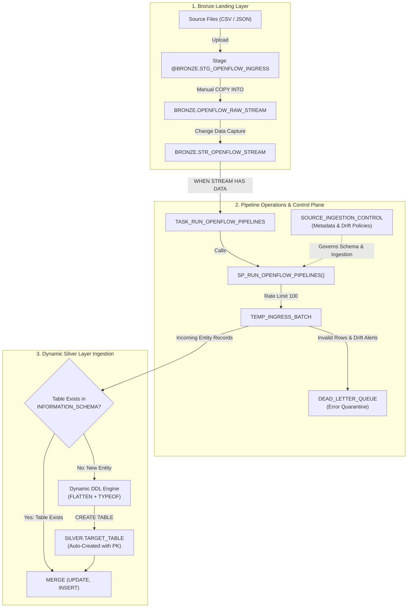
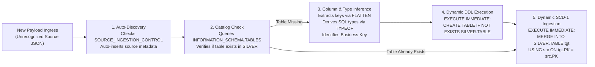
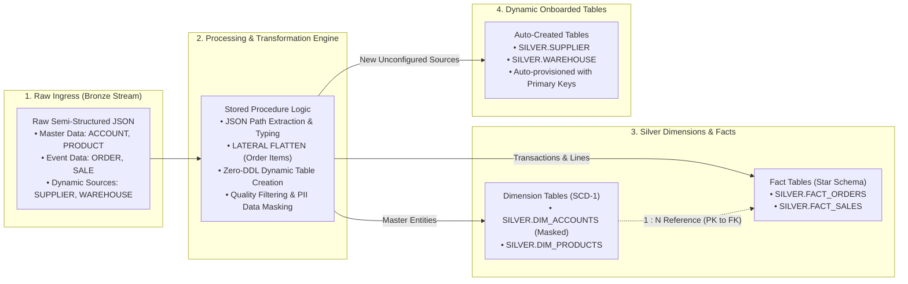
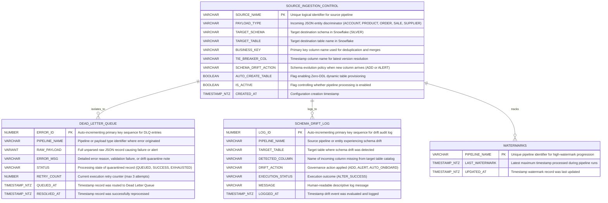

# Design Document: Event-Driven Retail Data Integration Framework

---

## 1. Document Overview

| Attribute | Details |
| :--- | :--- |
| **Framework Name** | Event-Driven Retail Data Integration Framework |
| **Target System** | Snowflake Cloud Data Platform |
| **Architecture Pattern** | Medallion Layer (Bronze → Silver) with Star Schema & CDC |

---

## 2. Business Purpose & Scope

### 2.1 Business Problem
Organizations face high cloud costs, rigid batch schedules, and fragile ETL pipelines where a single bad record crashes downstream reporting and customer data privacy is exposed.

### 2.2 Solution Objectives
* **Event-Driven & FinOps Aware**: Compute warehouses run only when new data lands, spending zero credits when idle.
* **Resilient Data Quality**: Corrupted rows are isolated into a Dead Letter Queue (DLQ) without halting the pipeline.
* **Governed Dimensional Modeling**: Raw JSON is modeled into clean Star Schema Dimensions and Facts with Primary/Foreign Key relations.
* **Regulatory Privacy**: Customer PII is dynamically masked for business analysts.

---

## 3. End-to-End Architecture

### 3.1 Dynamic Table Creation Flow (When New Entity Data Arrives)

When raw data lands with an unconfigured or brand-new entity name, the pipeline automatically provisions the target table at runtime with zero manual DDL:

| Stage | Snowflake Mechanism | Action Performed |
| :--- | :--- | :--- |
| **1. Entity Auto-Discovery** | `QUALIFY ROW_NUMBER()` + `NOT EXISTS` | Detects new `PAYLOAD_TYPE` values in `TEMP_INGRESS_BATCH` and automatically registers them into `PIPELINE_OPS.SOURCE_INGESTION_CONTROL` with default `ADD` drift policy. |
| **2. Catalog Verification** | `INFORMATION_SCHEMA.TABLES` | Queries `TABLE_SCHEMA = 'SILVER' AND TABLE_NAME = :v_cur_target_table` to determine whether dynamic creation is required. |
| **3. Type Inference** | `LATERAL FLATTEN` + `TYPEOF(f.VALUE)` | Inspects raw JSON values row-by-row at runtime to infer native SQL types (`INT`, `NUMBER(12,2)`, `BOOLEAN`, `TIMESTAMP_NTZ`, `VARIANT`, `VARCHAR(150)`). |
| **4. Zero-DDL Execution** | `LISTAGG()` + `EXECUTE IMMEDIATE` | Assembles column definitions into `CREATE TABLE IF NOT EXISTS SILVER.<TABLE>` with audit column `ETL_LOADED_AT` and 7-day Time Travel, then runs it dynamically. |
| **5. SCD-1 Merge Ingestion** | Dynamic `MERGE INTO` | Generates a dynamic `MERGE INTO` statement with `GET_IGNORE_CASE()` to insert new rows and update changed records based on the discovered business key. |

---

## 4. Simplified Data Modeling (Core Tables + Dynamic Future Tables)

### 4.1 Schema Breakdown

| Schema | Purpose | Retention | Key Objects |
| :--- | :--- | :--- | :--- |
| **`BRONZE`** | Raw file staging and initial table landing. | 1 Day (Transient) | Stage `STG_OPENFLOW_INGRESS`, Table `OPENFLOW_RAW_STREAM`, Stream `STR_OPENFLOW_STREAM`. |
| **`SILVER`** | Star Schema Dimensions, Facts, and dynamic onboarded tables. | 7 Days (Time Travel) | **Core Tables**: `DIM_ACCOUNTS`, `DIM_PRODUCTS`, `FACT_ORDERS`, `FACT_SALES` **Dynamic / Future Tables**: `SUPPLIER`, `WAREHOUSE`, `SHIPMENT`. |
| **`PIPELINE_OPS`** | Pipeline control plane, metadata governance, and error isolation. | Standard | `SOURCE_INGESTION_CONTROL`, `DEAD_LETTER_QUEUE`, Stored Procedure, Task. |

### 4.2 Data Modeling Flowchart (Expanded 4-Block Ingestion Flow)

### 4.3 Star Schema Data Model (Core Tables + Dynamic Future Tables)

```mermaid
erDiagram

    %% =========================================================================
    %% RELATIONSHIPS
    %% =========================================================================
    DIM_ACCOUNTS ||--o{ FACT_ORDERS : places
    DIM_PRODUCTS ||--o{ FACT_SALES : ordered_in
    FACT_ORDERS ||--|{ FACT_SALES : contains
    FACT_ORDERS ||--o{ SHIPMENT : tracks_delivery
    SUPPLIER ||--o{ DIM_PRODUCTS : supplies
    WAREHOUSE ||--o{ FACT_SALES : fulfills

    %% =========================================================================
    %% ENTITY DEFINITIONS WITH COMMENTS
    %% =========================================================================
    DIM_ACCOUNTS {
        VARCHAR ACCOUNT_ID PK "Primary key for customer account"
        VARCHAR ACCOUNT_NAME "Customer legal business name (Masked for Analysts via Dynamic Policy)"
        VARCHAR TIER "Customer classification tier (ENTERPRISE, MID_MARKET, STANDARD)"
        VARCHAR INDUSTRY "Business domain sector (Auto-evolved via Schema Drift ADD policy)"
        VARCHAR REGION "Sales operating region (Auto-evolved via Schema Drift ADD policy)"
        BOOLEAN IS_DELETED "Soft-delete flag indicating account status"
        TIMESTAMP_NTZ UPDATED_AT "Source system last modification timestamp"
        TIMESTAMP_NTZ ETL_LOADED_AT "Snowflake pipeline ingestion timestamp"
    }

    DIM_PRODUCTS {
        VARCHAR PRODUCT_ID PK "Primary key for catalog product"
        VARCHAR PRODUCT_NAME "Product marketing title and catalog description"
        VARCHAR CATEGORY "Item category classification (Electronics, Accessories)"
        NUMBER UNIT_PRICE "Base catalog unit sales price"
        VARCHAR SUPPLIER_ID FK "Foreign key referencing fulfilling SUPPLIER"
        TIMESTAMP_NTZ UPDATED_AT "Source catalog last update timestamp"
        TIMESTAMP_NTZ ETL_LOADED_AT "Snowflake pipeline ingestion timestamp"
    }

    FACT_ORDERS {
        NUMBER ORDER_ID PK "Primary key for customer order transaction header"
        VARCHAR CUSTOMER_ID FK "Foreign key referencing DIM_ACCOUNTS(ACCOUNT_ID)"
        VARCHAR ORDER_STATUS "Order fulfillment lifecycle state (COMPLETED, PENDING, CANCELLED)"
        VARCHAR PAYMENT_METHOD "Payment instrument utilized (CREDIT_CARD, PAYPAL, INVOICE)"
        TIMESTAMP_NTZ ORDER_TIMESTAMP "Order placement timestamp used for watermark tracking"
        TIMESTAMP_NTZ ETL_LOADED_AT "Snowflake pipeline ingestion timestamp"
    }

    FACT_SALES {
        NUMBER SALE_ID PK "Primary key for individual item transaction line"
        NUMBER ORDER_ID FK "Foreign key referencing parent FACT_ORDERS(ORDER_ID)"
        VARCHAR PRODUCT_ID FK "Foreign key referencing purchased DIM_PRODUCTS(PRODUCT_ID)"
        VARCHAR WAREHOUSE_ID FK "Foreign key referencing fulfilling facility WAREHOUSE(WAREHOUSE_ID)"
        NUMBER QUANTITY "Units ordered in this line item"
        NUMBER UNIT_PRICE "Executed unit sale price at time of purchase"
        NUMBER DISCOUNT_AMOUNT "Promotional discount deducted from sale"
        NUMBER NET_REVENUE "Computed net revenue (Quantity * Price - Discount)"
        VARCHAR PAYMENT_METHOD "Payment instrument applied to line transaction"
        TIMESTAMP_NTZ SALE_TIMESTAMP "Timestamp transaction was executed"
        TIMESTAMP_NTZ ETL_LOADED_AT "Snowflake pipeline ingestion timestamp"
    }

    SUPPLIER {
        VARCHAR SUPPLIER_ID PK "Dynamic business key auto-derived from JSON payload (_ID)"
        VARCHAR SUPPLIER_NAME "Vendor company legal name"
        VARCHAR COUNTRY "Origin country of supplier operations"
        NUMBER RATING "Performance and quality rating score (0.0 to 5.0)"
        VARCHAR STATUS "Operational vendor status (ACTIVE, INACTIVE)"
        TIMESTAMP_NTZ UPDATED_AT "Source vendor last update timestamp"
        TIMESTAMP_NTZ ETL_LOADED_AT "Snowflake pipeline ingestion timestamp"
    }

    WAREHOUSE {
        VARCHAR WAREHOUSE_ID PK "Dynamic business key auto-derived from JSON payload (_ID)"
        VARCHAR WAREHOUSE_NAME "Physical distribution center or fulfillment facility name"
        VARCHAR CITY "City location of fulfillment facility"
        VARCHAR STATE "State or territory of facility"
        NUMBER CAPACITY_SQFT "Total facility storage capacity in square feet"
        VARCHAR STATUS "Operating facility status (ACTIVE, INACTIVE)"
        TIMESTAMP_NTZ UPDATED_AT "Source facility last update timestamp"
        TIMESTAMP_NTZ ETL_LOADED_AT "Snowflake pipeline ingestion timestamp"
    }

    SHIPMENT {
        VARCHAR SHIPMENT_ID PK "Dynamic business key auto-derived from JSON payload (_ID)"
        NUMBER ORDER_ID FK "Foreign key referencing parent FACT_ORDERS(ORDER_ID)"
        VARCHAR CARRIER "Logistics freight carrier (FEDEX, DHL, UPS)"
        VARCHAR TRACKING_NUMBER "Consignment package tracking code"
        NUMBER SHIPPING_COST "Freight and delivery transportation fee"
        VARCHAR STATUS "Shipment delivery state (IN_TRANSIT, DELIVERED, PENDING)"
        TIMESTAMP_NTZ UPDATED_AT "Source carrier last update timestamp"
        TIMESTAMP_NTZ ETL_LOADED_AT "Snowflake pipeline ingestion timestamp"
    }
```

### 4.4 Control Plane Data Model (Pipeline Operations)

---

## 5. Code Plane & Execution Logic

### 5.1 Step-by-Step Flow inside `SP_RUN_OPENFLOW_PIPELINES()`

1. **Rate-Limited Delta Staging**:
   * Pulls up to 100 unconsumed rows from `BRONZE.STR_OPENFLOW_STREAM` into a session-scoped `TEMP_INGRESS_BATCH`.
   * Advances the stream bookmark and resets `SYSTEM$STREAM_HAS_DATA` to `FALSE`.
2. **Metadata-Driven Control Plane (Dynamic Zero-DDL Onboarding)**:
   * Scans `PIPELINE_OPS.SOURCE_INGESTION_CONTROL` for sources configured with `AUTO_CREATE_TABLE = TRUE` (or auto-discovers unconfigured new payload types).
   * When data arrives for an onboarded source (e.g., `SUPPLIER`, `WAREHOUSE`, `SHIPMENT`) and the target table does not yet exist:
     * Derives column data types dynamically from incoming JSON keys (`VARCHAR`, `INT`, `NUMBER`, `BOOLEAN`, `ARRAY`, `TIMESTAMP_NTZ`).
     * Automatically constructs and executes `CREATE TABLE IF NOT EXISTS SILVER.<TARGET_TABLE>` with designated primary key and time travel retention.
     * Generates and executes dynamic SCD Type 1 `MERGE INTO SILVER.<TARGET_TABLE>` using the configured `BUSINESS_KEY` and tie-breaker column.
     * Emits audit event `'TABLE_CREATED'` into `PIPELINE_OPS.SCHEMA_DRIFT_LOG` and updates operational metrics.
3. **Runtime Schema Drift Governance (Zero Pre-Defined Column Lists with ADD vs ALERT)**:
   * Inspects incoming JSON keys against actual target table columns via `INFORMATION_SCHEMA.COLUMNS` with zero hardcoded column lists.
   * Dynamically infers exact SQL data types from incoming JSON values (`INT`, `NUMBER(12,2)`, `BOOLEAN`, `TIMESTAMP_NTZ`, `VARCHAR(150)`, `VARIANT`).
   * Evaluates policy defined in `PIPELINE_OPS.SOURCE_INGESTION_CONTROL` / `SCHEMA_EVOLUTION_CONTROL`:
     * **`'ADD'` Policy**: Automatically executes `ALTER TABLE SILVER.<TARGET_TABLE> ADD COLUMN IF NOT EXISTS <COL> <INFERRED_DATA_TYPE>` and generically updates values from the batch using the entity's `BUSINESS_KEY`.
     * **`'ALERT'` Policy**: Quarantines records containing unexpected columns into `PIPELINE_OPS.DEAD_LETTER_QUEUE` with error `SCHEMA_DRIFT_ALERT`, logs the incident in `PIPELINE_OPS.SCHEMA_DRIFT_LOG`, and preserves table integrity.
4. **Dynamic Flattening Selection for Nested JSON**:
   * Inspects incoming batch for nested array structures (`IS_ARRAY(RAW_RECORD:items)`).
   * **Flattening Required (`DYNAMIC_FLATTEN_APPLIED`)**: Engages `LATERAL FLATTEN` on the nested array to unpack 1-to-many child line items into `SILVER.FACT_SALES` alongside the parent `FACT_ORDERS`.
   * **No Flattening Needed (`DIRECT_NO_FLATTEN`)**: Directly parses flat JSON payloads without lateral join overhead.
5. **Quality Validation & DLQ Trapping**:
   * Validates `order_id > 0`, `customer_id IS NOT NULL`, and `net_revenue >= 0`.
   * Corrupt rows are isolated into `DEAD_LETTER_QUEUE` with status `'QUEUED'`.
6. **Automated DLQ Retry**:
   * Evaluates previously queued errors where `RETRY_COUNT < 3`.
   * If fixed or dependencies resolved, merges into Silver and marks status `'SUCCESS'`.
   * After 3 failed attempts, status permanently marks `'EXHAUSTED'`.
7. **Dimension & Fact Merges (SCD Type 1)**:
   * Merges `DIM_ACCOUNTS` (with soft-delete support and auto-added drifted columns).
   * Merges `DIM_PRODUCTS` (catalog pricing updates).
   * Merges `FACT_ORDERS` and updates `PIPELINE_OPS.WATERMARKS`.
   * Merges `FACT_SALES` line items (from unnested arrays or flat sales).
8. **Observability & Resource Monitor Email**:
   * Records batch counts, drift events, flattening strategy, and dynamic onboarding metrics in `PIPELINE_METRICS`.
   * Checks `RESOURCE MONITOR RM_PROD` quota (50 credits) via `RESULT_SCAN`.
   * Sends execution report email via `SYSTEM$SEND_EMAIL`.

---

## 6. Security, Governance & FinOps

### 6.1 Role-Based Access Control (RBAC)

| Role | Privileges | Business Function |
| :--- | :--- | :--- |
| **`ACCOUNTADMIN`** | Full account administration. | Creates databases, resource monitors, notification integrations, and tasks. |
| **`ROLE_DATA_ENGINEER`** | DDL/DML on Bronze, Silver, Ops; Stage Read/Write; Execute SP. | Ingests data, manages schemas, maintains pipeline. |
| **`ROLE_ANALYST`** | `SELECT` on Silver tables (including future tables), Ops views, and Stage read. | Reviews Silver tables and pipeline metrics; cannot modify raw data. |

### 6.2 Data Masking (PII Protection)
* **Policy**: `SILVER.MASK_ACCOUNT_NAME`
* **Rule**:
  * `ACCOUNTADMIN` & `ROLE_DATA_ENGINEER` see full plain text: `"Apple Retail Inc"`
  * `ROLE_ANALYST` sees masked text: `"Ap**** (Masked)"`

### 6.3 FinOps Cost Controls
* **Transient Bronze**: Eliminates Fail-safe storage costs after 24 hours.
* **Stream Task Gate**: Warehouse `WH_PROD` wakes up only when `SYSTEM$STREAM_HAS_DATA = TRUE`.
* **Resource Monitor Alerting**: Hard credit limits track usage against the 50-credit allocation.

---

## 7. Summary of Framework Features

| Feature | Implementation Details |
| :--- | :--- |
| **CDC Handling** | Added native CDC Streams & Automated Tasks |
| **Data Model** | Full Star Schema (Dimensions, Facts, Foreign Keys) in Silver Layer |
| **Metadata-Driven Control Plane** | Zero-DDL dynamic onboarding via `SOURCE_INGESTION_CONTROL` with runtime table creation and automated SCD-1 MERGE |
| **Schema Drift Governance** | Runtime column detection with configurable `ADD` (auto-alter table) and `ALERT` (quarantine DLQ) |
| **Nested JSON Processing** | Intelligent dynamic flattening selection (flattens only when nested arrays exist; direct parse if flat) |
| **Governance** | RBAC (`ROLE_DATA_ENGINEER`, `ROLE_ANALYST` with `FUTURE TABLES` access) + Dynamic Data Masking |
| **Observability** | Metrics table with visual health badges (`🟢`, `🟡`, `🔴`), drift logging, onboarding metrics & credit alerts |

---

## 8. Future Work & Roadmap

1. **Serverless Snowpipe Ingestion**: Transition from scheduled batch `COPY INTO` to continuous, event-driven streaming as files land in external cloud storage (AWS S3 / Azure).
2. **Operational Replay & Archival Lifecycle**: Automatically move ingested files to an archive stage, enabling date-level historical replay (`FORCE = TRUE`) with automated retention cleanup.
