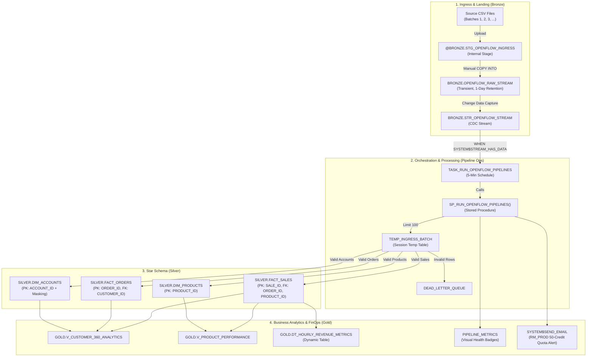
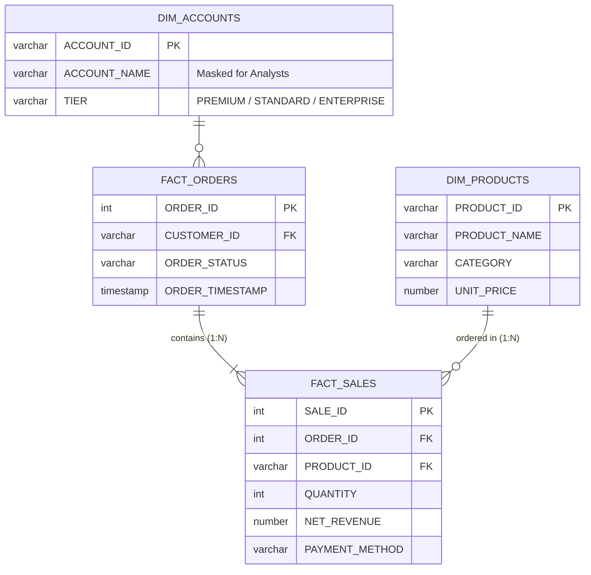

# Design Document: Event-Driven Retail Data Integration Framework

---

## 1. Document Overview

| Attribute | Details |
| :--- | :--- |
| **Framework Name** | Event-Driven Retail Data Integration Framework |
| **Target System** | Snowflake Cloud Data Platform |
| **Architecture Pattern** | Medallion Layer (Bronze → Silver → Gold) with Star Schema & CDC |

---

## 2. Business Purpose & Scope

### 2.1 Business Problem
Organizations face high cloud costs, rigid batch schedules, and fragile ETL pipelines where a single bad record crashes downstream reporting and customer data privacy is exposed.

### 2.2 Solution Objectives
* **Event-Driven & FinOps Aware**: Compute warehouses run only when new data lands, spending zero credits when idle.
* **Resilient Data Quality**: Corrupted rows are isolated into a Dead Letter Queue (DLQ) without halting the pipeline.
* **Governed Dimensional Modeling**: Raw JSON is modeled into clean Star Schema Dimensions and Facts with Primary/Foreign Key relations.
* **Regulatory Privacy**: Customer PII is dynamically masked for business analysts.

---

## 3. End-to-End Architecture

---

## 4. Medallion Schema Architecture

### 4.1 Schema Breakdown

| Schema | Purpose | Retention | Key Objects |
| :--- | :--- | :--- | :--- |
| **`BRONZE`** | Raw file staging and initial table landing. | 1 Day (Transient) | Stage `STG_OPENFLOW_INGRESS`, Table `OPENFLOW_RAW_STREAM`, Stream `STR_OPENFLOW_STREAM`. |
| **`SILVER`** | Star Schema Dimensions and Facts with referential integrity. | 7 Days (Time Travel) | `DIM_ACCOUNTS`, `DIM_PRODUCTS`, `FACT_ORDERS`, `FACT_SALES`. |
| **`GOLD`** | Business aggregation views and real-time dynamic tables. | View Layer | `V_CUSTOMER_360_ANALYTICS`, `V_PRODUCT_PERFORMANCE`, `DT_HOURLY_REVENUE_METRICS`. |
| **`PIPELINE_OPS`** | Pipeline control plane, error tracking, and monitoring. | Standard | `DEAD_LETTER_QUEUE`, `PIPELINE_METRICS`, Stored Procedure, Task. |

### 4.2 Silver Star Schema Relationships

---

## 5. Code Plane & Execution Logic

### 5.1 Step-by-Step Flow inside `SP_RUN_OPENFLOW_PIPELINES()`

1. **Rate-Limited Delta Staging**:
   * Pulls up to 100 unconsumed rows from `BRONZE.STR_OPENFLOW_STREAM` into a session-scoped `TEMP_INGRESS_BATCH`.
   * Advances the stream bookmark and resets `SYSTEM$STREAM_HAS_DATA` to `FALSE`.
2. **Quality Validation & DLQ Trapping**:
   * Validates `order_id > 0`, `customer_id IS NOT NULL`, and `net_revenue >= 0`.
   * Corrupt rows are trapped in `DEAD_LETTER_QUEUE` with status `'QUEUED'`.
3. **Automated DLQ Retry**:
   * Evaluates previously queued errors where `RETRY_COUNT < 3`.
   * If fixed or dependencies resolved, merges into Silver and marks status `'SUCCESS'`.
   * After 3 failed attempts, status permanently marks `'EXHAUSTED'`.
4. **Dimension & Fact Merges (SCD Type 1)**:
   * Merges `DIM_ACCOUNTS` (with soft-delete support).
   * Merges `DIM_PRODUCTS` (catalog pricing updates).
   * Merges `FACT_ORDERS` and updates `PIPELINE_OPS.WATERMARKS`.
   * Merges `FACT_SALES` line items.
5. **Observability & Resource Monitor Email**:
   * Records batch counts and throughput in `PIPELINE_METRICS`.
   * Checks `RESOURCE MONITOR RM_PROD` quota (50 credits) via `RESULT_SCAN`.
   * Sends execution report email via `SYSTEM$SEND_EMAIL`.

---

## 6. Security, Governance & FinOps

### 6.1 Role-Based Access Control (RBAC)

| Role | Privileges | Business Function |
| :--- | :--- | :--- |
| **`ACCOUNTADMIN`** | Full account administration. | Creates databases, resource monitors, notification integrations, and tasks. |
| **`ROLE_DATA_ENGINEER`** | DDL/DML on Bronze, Silver, Ops; Stage Read/Write; Execute SP. | Ingests data, manages schemas, maintains pipeline. |
| **`ROLE_ANALYST`** | `SELECT` on Silver tables, Gold views, and Stage read. | Consumes analytics and reports; cannot modify raw data. |

### 6.2 Data Masking (PII Protection)
* **Policy**: `SILVER.MASK_ACCOUNT_NAME`
* **Rule**:
  * `ACCOUNTADMIN` & `ROLE_DATA_ENGINEER` see full plain text: `"Apple Retail Inc"`
  * `ROLE_ANALYST` sees masked text: `"Ap**** (Masked)"`

### 6.3 FinOps Cost Controls
* **Transient Bronze**: Eliminates Fail-safe storage costs after 24 hours.
* **Stream Task Gate**: Warehouse `WH_PROD` wakes up only when `SYSTEM$STREAM_HAS_DATA = TRUE`.
* **Resource Monitor Alerting**: Hard credit limits track usage against the 50-credit allocation.

---

## 7. Summary of Framework Features

| Feature | Implementation Details |
| :--- | :--- |
| **CDC Handling** | Added native CDC Streams & Automated Tasks |
| **Data Model** | Full Star Schema (Dimensions, Facts, Foreign Keys) + Gold Views |
| **Governance** | RBAC (`ROLE_DATA_ENGINEER`, `ROLE_ANALYST`) + Dynamic Data Masking |
| **Observability** | Metrics table with visual health badges (`🟢`, `🟡`, `🔴`) + Credit emails |

---

## 8. Future Work & Roadmap

1. **Metadata-Driven Control Plane**: Onboard new source tables dynamically through metadata configuration rows (`SOURCE_INGESTION_CONTROL`) with zero manual DDL coding.
2. **Serverless Snowpipe Ingestion**: Transition from scheduled batch `COPY INTO` to continuous, event-driven streaming as files land in external cloud storage (AWS S3 / Azure).
3. **Automated Schema Drift Governance**: Detect newly added columns at runtime and automatically apply configurable `ADD` (auto-alter table) or `ALERT` (quarantine) policies.
4. **Operational Replay & Archival Lifecycle**: Automatically move ingested files to an archive stage, enabling date-level historical replay (`FORCE = TRUE`) with automated retention cleanup.
