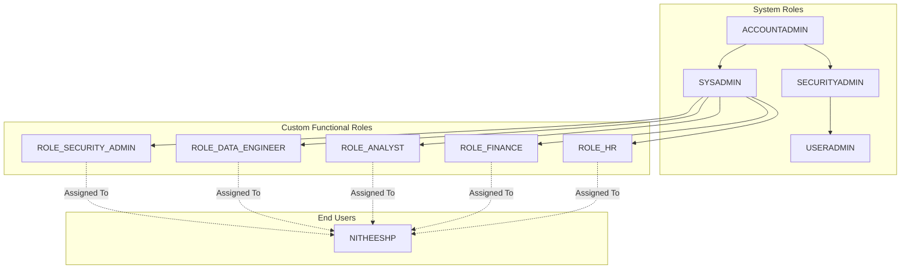

# Snowflake Access Control and RBAC Framework

## Purpose and Scope
This document outlines the enterprise Role-Based Access Control (RBAC) governance framework in Snowflake.
A central role-based access model defines permissions per business role, ensuring strict domain boundaries, separation of duties, and least-privilege access.

### In-Scope
- 5 functional custom roles: Engineer, Analyst, Finance, HR, Security Admin
- Role hierarchy rolling up to `SYSADMIN`
- Dedicated virtual warehouses per functional team
- Functional domain schemas (`FINANCE_SCHEMA`, `HR_SCHEMA`, `ENGINEERING_DEV`)
- Delegated grant administration (`ROLE_SECURITY_ADMIN`)
- Access validation testing and privilege audit reporting

### Assumptions
- Snowflake is the central data cloud platform.
- Custom roles are created by `USERADMIN` and granted by `SECURITYADMIN`.
- System administrators manage objects through `SYSADMIN`.
- Finance and HR domains are confidential and strictly isolated.
- Warehouses operate with `XSMALL` size and 60-second auto-suspend.

---

## Design Principles
- Least Privilege - Access granted only to the minimum required securable objects and actions
- Separation of Duties - Grant management separated from functional business data operations
- Domain Isolation - HR and Finance schemas strictly isolated with zero cross-departmental access
- Role Hierarchy - Custom functional roles roll up to `SYSADMIN` for central governance
- Compute Isolation - Dedicated warehouse per team avoids contention and enables cost tracking
- Observability - Audit and validate all role assignments and effective user privileges

---

## Architecture Overview

---

## Control Plane

### Functional Roles & Warehouses Configuration
- **Warehouses**: `WH_ENGINEER`, `WH_ANALYST`, `WH_FINANCE`, `WH_HR` (`XSMALL`, 60-sec auto-suspend)
- **Schemas**: `ENGINEERING_DEV` (Dev), `FINANCE_SCHEMA` (Finance), `HR_SCHEMA` (HR)
- **Grant Admin Role**: `ROLE_SECURITY_ADMIN` with `MANAGE GRANTS` privilege

### Governance Matrix

| Securable Object | Engineer | Analyst | Finance | HR | Security Admin |
| :--- | :---: | :---: | :---: | :---: | :---: |
| **Warehouse** | Operate | Usage | Usage | Usage | None |
| **Database** | Create/Modify | Read | Read | Read | None |
| **Finance Tables** | No | Read | Full DML | No | None |
| **HR Tables** | No | No | No | Full DML | None |
| **Account Privileges** | None | None | None | None | MANAGE GRANTS |

---

## Code Plane

### SQL Scripts
- `access_control.sql` contains:
  - Database and functional schema creation
  - Dedicated virtual warehouse provisioning
  - Finance and HR seed tables
  - Custom functional role creation via `USERADMIN`
  - Role hierarchy rollup to `SYSADMIN` via `SECURITYADMIN`
  - Warehouse, database, schema, and object privilege grants
  - Future table grants (`ON FUTURE TABLES`) for lifecycle resilience
  - Delegated `MANAGE GRANTS` privilege grant to `ROLE_SECURITY_ADMIN`
  - Validation test queries (positive and negative permission tests)

---

## Observability Plane

### Audit Reporting
Tracks effective entitlements and privilege assignments:
- **Grantee Name** - Custom functional role name
- **User Name** - Enterprise user name
- **Securable Object** - Object type (`WAREHOUSE`, `DATABASE`, `SCHEMA`, `TABLE`)
- **Object Name** - Target securable object name
- **Privilege** - Granted action (`USAGE`, `SELECT`, `OPERATE`, etc.)
- **Granted By** - Role that issued the grant

### Alerts
- Unauthorized access or permission denial errors
- Analyst role attempting DML operations on Finance data
- Cross-domain access attempts between HR and Finance
- Changes to role hierarchy or system role inheritance
- Direct grants issued outside standard governance process

---

## Deployment and Release Management
- Scripts versioned in Git (Feature $\rightarrow$ Dev $\rightarrow$ Main).
- Peer review required before merging.
- Tested in Dev before deploying to Prod.

---

## Decisions
- Dedicated warehouse per team ensures compute isolation and cost attribution.
- Functional roles roll up to `SYSADMIN` for centralized object management.
- `ROLE_SECURITY_ADMIN` manages grants via delegated `MANAGE GRANTS`.
- Future table grants prevent permission drift on newly created tables.
- Finance and HR domains strictly isolated with zero cross-access.

---

## To Be Discussed
- Secondary role enforcement policies (`USE SECONDARY ROLES NONE`).
- SCIM automated user and group provisioning from identity providers (IdP).
- Session timeout policy customization per functional role.
