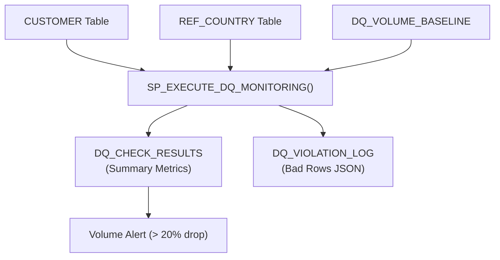

# Snowflake Data Quality Monitoring Framework

## Purpose and Scope
This document outlines an automated Data Quality (DQ) monitoring framework in Snowflake.
A central stored procedure validates customer data against 5 quality rules, records summary metrics, and quarantines bad rows into a violation log.

### In-Scope
- 5 validation checks: Duplicate, Null, Referential, Freshness, and Volume
- Central procedure: `SP_EXECUTE_DQ_MONITORING()`
- Summary metrics table: `DQ_CHECK_RESULTS`
- Row-level violation table: `DQ_VIOLATION_LOG`
- Baseline comparison table: `DQ_VOLUME_BASELINE`

### Assumptions
- Snowflake is the central data platform.
- Customer data lives in `CUSTOMER_SCHEMA.CUSTOMER`.
- Reference country codes live in `CUSTOMER_SCHEMA.REF_COUNTRY`.
- Quality objects reside in `DATA_QUALITY` schema.
- Checks execute on virtual warehouse `WH_ENGINEER`.

---

## Design Principles
- Automated - Procedure executes all 5 checks in a single call
- Two-Tier Logging - High-level summary metrics plus detailed bad rows
- Isolation - Quality tools separated from production customer tables
- Dynamic Baselines - Volume checked against previous run row counts
- Observability - Fast status checks using simple SELECT queries

---

## Architecture Overview

---

## Control Plane

### Target Tables Configuration
- **Source**: `CUSTOMER` (`CUSTOMER_ID`, `CUSTOMER_NAME`, `EMAIL`, `COUNTRY_CODE`, `LOAD_DATE`)
- **Reference**: `REF_COUNTRY` (`COUNTRY_CODE`, `COUNTRY_NAME`)
- **Baseline**: `DQ_VOLUME_BASELINE` (`BASELINE_NAME`, `PREVIOUS_ROW_COUNT`, `RECORDED_DATE`)
- **Results**: `DQ_CHECK_RESULTS` (Summary metrics per rule)
- **Violations**: `DQ_VIOLATION_LOG` (Bad row details and payload JSON)

### Governance Matrix

| Rule ID | Metric Name | Target Column | Validation Logic | Failure Condition | Threshold |
| :--- | :--- | :--- | :--- | :--- | :---: |
| **Rule 1** | Duplicate Check | `CUSTOMER_ID` | Group by ID with count > 1 | Duplicates > 0 | 0 |
| **Rule 2** | Null Check | `EMAIL` | Check for NULL values | Value IS NULL | 0 |
| **Rule 3** | Referential Check | `COUNTRY_CODE` | Check against `REF_COUNTRY` | Code not in reference | 0 |
| **Rule 4** | Freshness Check | `LOAD_DATE` | Compare with `CURRENT_DATE()` | Date != Today | 0 |
| **Rule 5** | Volume Check | Row Count | Compare count to baseline | Volume drop > 20% | Max 20% drop |

---

## Code Plane

### SQL Scripts
- `data_quality_monitoring.sql` contains:
  - Schema setup (`CUSTOMER_SCHEMA`, `DATA_QUALITY`)
  - Reference and customer tables seeded with test violations
  - Quality tables (`DQ_VOLUME_BASELINE`, `DQ_CHECK_RESULTS`, `DQ_VIOLATION_LOG`)
  - Central procedure `SP_EXECUTE_DQ_MONITORING()`
  - Execution queries validating all 5 DQ checks and anomaly alerts

---

## Observability Plane

### Summary Results Table (`DQ_CHECK_RESULTS`)
- **Check Timestamp** - Timestamp when check ran
- **Rule ID** - Rule number (`RULE_1` to `RULE_5`)
- **Metric Name** - Name of validation test
- **Failed Records** - Count of bad records detected
- **Status** - `PASS` or `FAIL`
- **Details** - Rule explanation or volume drop percentage

### Violation Log Table (`DQ_VIOLATION_LOG`)
- **Check Timestamp** - Timestamp violation was captured
- **Rule ID** - Identifier of failed rule
- **Violation Type** - Short failure description
- **Record Identifier** - Offending `CUSTOMER_ID`
- **Record Details** - Complete bad row payload captured as JSON (`VARIANT`)

### Alerts
- Any rule status equals `FAIL`
- Duplicate customer IDs detected
- Customer email is NULL
- Country code not in `REF_COUNTRY`
- Load date is not today
- Daily volume drops by more than 20%

---

## Deployment and Release Management
- Scripts versioned in Git (Feature $\rightarrow$ Dev $\rightarrow$ Main).
- Peer review required before merging.
- Tested in Dev before deploying to Prod.

---

## Decisions
- Dedicated `DATA_QUALITY` schema isolates monitoring tools from business data.
- Single stored procedure runs all 5 checks together on warehouse `WH_ENGINEER`.
- High-level metrics stored in summary table; bad rows isolated in violation table.
- Bad rows stored as JSON (`VARIANT`) via `OBJECT_CONSTRUCT(*)` for full auditability.
- Tables refresh on each run to reflect current health status.

---

## To Be Discussed
- Schedule procedure execution using a Snowflake Task.
- Send automated Slack/email alerts on rule failure.
- Store historical check trends instead of overwriting results.
- Implement 7-day rolling average for volume baselines.
