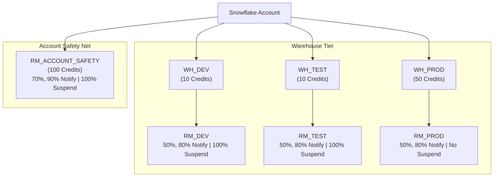

# Snowflake Resource Monitor Cost Governance

## Purpose and Scope
This document outlines cost governance in Snowflake using Resource Monitors.
A central monitoring framework tracks credit consumption across DEV, TEST, and PROD environments, with an account-level safety net to prevent runaway credit usage.

### In-Scope
- Warehouse-level Resource Monitors (DEV, TEST, PROD)
- Account-level Resource Monitor (`RM_ACCOUNT_SAFETY`)
- Monthly credit quotas and notification thresholds
- Automated warehouse suspension for non-production environments
- Observability and status reporting table

### Assumptions
- Snowflake is the central data platform.
- DEV, TEST, and PROD operate on dedicated virtual warehouses.
- Credit quotas reset monthly.
- Production workloads are business-critical and never auto-suspended.
- Account-level administrative privileges are used for configuration.

---

## Design Principles
- Cost Governance - Monitor and control credit consumption across all environments
- Environment Isolation - Dedicated warehouse and resource monitor per environment
- Production Protection - PROD generates alerts but does not auto-suspend
- Defense in Depth - Warehouse-level quotas combined with an account-level safety net
- Cost Efficiency - Warehouses use `XSMALL` size with 60-second auto-suspend
- Observability - Resource Monitor metrics stored for reporting and dashboards

---

## Architecture Overview

---

## Control Plane

### Warehouse Configuration
- **Warehouses**: `WH_DEV`, `WH_TEST`, `WH_PROD` (`XSMALL`, 60-sec auto-suspend, auto-resume enabled)
- **Governance Database & Schema**: `GOVERNANCE_DB.MONITORING`

### Governance Matrix

| Environment | Warehouse | Size | Resource Monitor | Monthly Quota | Warning Thresholds | Auto Suspend |
| :--- | :--- | :---: | :--- | :---: | :---: | :---: |
| **DEV** | `WH_DEV` | `XSMALL` | `RM_DEV` | 10 credits | 50%, 80% | 100% |
| **TEST** | `WH_TEST` | `XSMALL` | `RM_TEST` | 10 credits | 50%, 80% | 100% |
| **PROD** | `WH_PROD` | `XSMALL` | `RM_PROD` | 50 credits | 50%, 80% | None (Alert Only) |
| **Account** | All | N/A | `RM_ACCOUNT_SAFETY` | 100 credits | 70%, 90% | 100% |

---

## Code Plane

### SQL Scripts
- `resource_monitoring.sql` contains:
  - Virtual warehouse provisioning for DEV, TEST, and PROD
  - Resource Monitor creation with monthly quotas and threshold actions
  - Monitor assignments to warehouses and account
  - Schema setup (`GOVERNANCE_DB.MONITORING`)
  - Status tracking table creation and refresh queries via `SHOW RESOURCE MONITORS`

---

## Observability Plane

### Resource Monitor Status Table
- **Monitor Name** - Configured monitor name
- **Credit Quota** - Configured monthly quota
- **Used Credits** - Credits consumed in current period
- **Usage Percentage** - Percentage of quota consumed
- **Remaining Credits** - Credits remaining in period
- **Frequency** - Schedule reset cycle (Monthly)
- **Suspend At** - Suspension threshold percentage
- **Notify At** - Notification threshold percentages

### Alerts
- DEV / TEST credit usage reaches 50% and 80% (Warning)
- DEV / TEST credit quota exhausted at 100% (Auto-suspended)
- PROD credit usage reaches 50% and 80% (Warning)
- PROD credit quota exhausted at 100% (Alert only, no suspension)
- Account credit usage reaches 70% and 90% (Warning)
- Account safety limit reached at 100% (Account-wide suspension)

---

## Deployment and Release Management
- Scripts versioned in Git (Feature $\rightarrow$ Dev $\rightarrow$ Main).
- Peer review required before merging.
- Tested in Dev before deploying to Prod.

---

## Decisions
- Dedicated warehouses for DEV, TEST, and PROD enable cost isolation.
- Warehouses configured with `XSMALL` size and 60-second auto-suspend.
- DEV and TEST automatically suspend at 100% quota to avoid waste.
- PROD alerts at 100% quota without auto-suspension to protect business operations.
- Account-level monitor set at 100 credits acts as a hard stop against runaway spend.

---

## To Be Discussed
- Notification delivery channels (Email, Slack, or PagerDuty integration).
- Account-level suspension escalation and override approval process.
- Procedure for temporary quota adjustments during peak loads.
- Historical usage retention (snapshot vs. continuous event tracking).