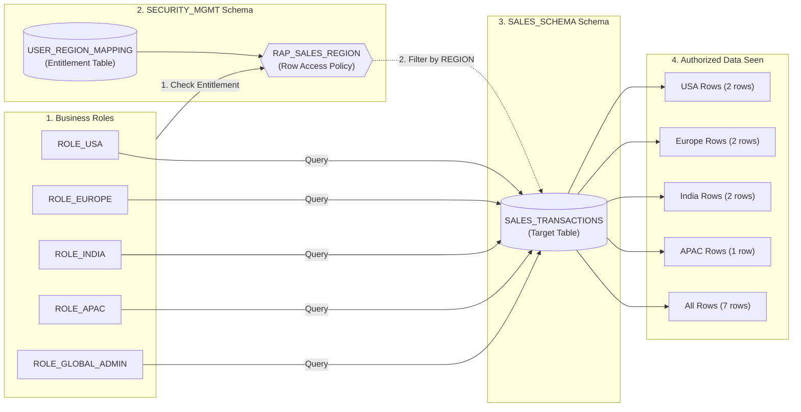

# Snowflake Dynamic Row Access Policy Framework

## Purpose and Scope
This document outlines the architecture, policy specifications, and governance guidelines for implementing Dynamic Row-Level Security (RLS) in Snowflake using Row Access Policies.
A central Row Access Policy filters sales transactions dynamically based on the querying user's active role using an entitlement mapping table.

### In-Scope
- 5 regional and administrative roles: `ROLE_USA`, `ROLE_EUROPE`, `ROLE_INDIA`, `ROLE_APAC`, `ROLE_GLOBAL_ADMIN`
- Schemas: `SALES_SCHEMA` (business data) and `SECURITY_MGMT` (security policy and mapping)
- Dynamic Row Access Policy: `RAP_SALES_REGION`
- Central entitlement mapping table: `USER_REGION_MAPPING`
- Target table: `SALES_SCHEMA.SALES_TRANSACTIONS`
- Verification testing across regional and administrative roles

### Assumptions
- Snowflake is the central data cloud platform.
- Sales transactions are stored in `SALES_SCHEMA.SALES_TRANSACTIONS`.
- Policy and mapping objects reside in `SECURITY_MGMT` schema.
- Roles are created by `USERADMIN` and granted to `SYSADMIN` by `SECURITYADMIN`.
- Queries execute on virtual warehouse `WH_ANALYST`.

---

## Design Principles
- Least Privilege - Users only see records authorized for their specific geographic region
- Dynamic Policy Evaluation - Entitlements evaluated at query runtime without modifying underlying data
- Centralized Entitlement Table - Access rules managed via mapping table without modifying the policy definition
- Separation of Duties - Security policies and mapping tables isolated in `SECURITY_MGMT` schema
- Administrative Transparency - Global administrators retain full visibility across all regions
- Observability - Policy bindings and row-level filtering validated through test queries

---

## Architecture Overview

### Schema Access & Data Visibility Matrix

| Role Name | SECURITY_MGMT Schema | SALES_SCHEMA Schema | Authorized Region | Visible Rows in SALES_TRANSACTIONS |
| :--- | :--- | :--- | :--- | :---: |
| **`ROLE_USA`** | `USAGE` (Policy Lookup) | `USAGE` + `SELECT` | USA | **2 rows** |
| **`ROLE_EUROPE`** | `USAGE` (Policy Lookup) | `USAGE` + `SELECT` | EUROPE | **2 rows** |
| **`ROLE_INDIA`** | `USAGE` (Policy Lookup) | `USAGE` + `SELECT` | INDIA | **2 rows** |
| **`ROLE_APAC`** | `USAGE` (Policy Lookup) | `USAGE` + `SELECT` | APAC | **1 row** |
| **`ROLE_GLOBAL_ADMIN`** | `USAGE` (Policy Lookup) | `USAGE` + `SELECT` | ALL (Global Admin) | **7 rows** |
| **`ACCOUNTADMIN`** | `USAGE` + Admin | `USAGE` + Admin | ALL (Admin Bypass) | **7 rows** |

---

## Control Plane
Tables, schemas, and policy definitions that govern row-level filtering.

### Target Tables & Objects Configuration
- **Target Table**: `SALES_SCHEMA.SALES_TRANSACTIONS` (`SALES_ID`, `CUSTOMER`, `REGION`, `SALES_AMOUNT`)
- **Mapping Table**: `SECURITY_MGMT.USER_REGION_MAPPING` (`ENTITY_NAME`, `ENTITY_TYPE`, `AUTHORIZED_REGION`)
- **Row Access Policy**: `SECURITY_MGMT.RAP_SALES_REGION` applied to `REGION` column
- **Schemas**: `SALES_SCHEMA` (Data Layer), `SECURITY_MGMT` (Governance Layer)
- **Roles**: `ROLE_USA`, `ROLE_EUROPE`, `ROLE_INDIA`, `ROLE_APAC`, `ROLE_GLOBAL_ADMIN`

### Governance Matrix

| Role Name | Entity Type | Authorized Region | Visible Regions | Expected Row Count |
| :--- | :--- | :--- | :--- | :---: |
| **ROLE_USA** | ROLE | USA | USA only | 2 rows |
| **ROLE_EUROPE** | ROLE | EUROPE | EUROPE only | 2 rows |
| **ROLE_INDIA** | ROLE | INDIA | INDIA only | 2 rows |
| **ROLE_APAC** | ROLE | APAC | APAC only | 1 row |
| **ROLE_GLOBAL_ADMIN** | ROLE | ALL | All Regions | 7 rows |
| **ACCOUNTADMIN** | ROLE | ALL | All Regions (Admin Bypass) | 7 rows |

---

## Code Plane
SQL execution script that sets up schemas, creates roles, defines the entitlement table, builds the policy, and executes validation tests.

### SQL Scripts
- `row_access_policy.sql` contains:
  - Schema creation (`SALES_SCHEMA`, `SECURITY_MGMT`)
  - Regional role provisioning via `USERADMIN` and hierarchy setup to `SYSADMIN`
  - Warehouse, database, and schema usage privilege grants
  - `SALES_TRANSACTIONS` table creation and data seeding
  - Entitlement mapping table (`USER_REGION_MAPPING`) creation and seeding
  - Dynamic Row Access Policy (`RAP_SALES_REGION`) definition
  - Policy association to `SALES_TRANSACTIONS.REGION`
  - Validation test queries across regional and administrative roles

---

## Observability Plane
Runtime verification, access auditing, and policy monitoring.

### Validation Test Results
- **ROLE_USA** - Retrieves only transactions where `REGION = 'USA'` (Rows: 101, 105)
- **ROLE_INDIA** - Retrieves only transactions where `REGION = 'INDIA'` (Rows: 103, 107)
- **ROLE_EUROPE** - Retrieves only transactions where `REGION = 'EUROPE'` (Rows: 102, 106)
- **ROLE_APAC** - Retrieves only transactions where `REGION = 'APAC'` (Row: 104)
- **ROLE_GLOBAL_ADMIN** - Retrieves all records across all regions (Rows: 101 to 107)

### Policy Auditing
- Verify active policy attachments using `POLICY_REFERENCES` Information Schema view.
- Track effective row counts and query execution history via `ACCOUNT_USAGE.QUERY_HISTORY`.

### Alerts
- Unauthorized region access attempts returning 0 rows unexpectedly
- Policy evaluation compilation errors or missing mapping entries
- Modifications to `USER_REGION_MAPPING` table by unauthorized non-admin roles
- Removal or detachment of `RAP_SALES_REGION` from target tables

---

## Deployment and Release Management
- Scripts versioned in Git (Feature $\rightarrow$ Dev $\rightarrow$ Main).
- Peer review required before deploying policy changes to Production.
- Tested in Dev/Test environments to verify positive and negative access before promotion.
- Production policy alterations follow standard change management approvals.

---

## Decisions
- Entitlement table lookup decouples authorization rules from policy code, enabling dynamic access updates without DDL changes.
- Dedicated `SECURITY_MGMT` schema protects policy logic and mapping tables from business users.
- Role-based and user-based lookups supported via `ENTITY_TYPE` column for flexible access governance.
- Administrative bypass included for `ACCOUNTADMIN` and `ROLE_GLOBAL_ADMIN` for system management and reporting.
- Native Snowflake Row Access Policy ensures query-level performance optimization and seamless BI integration.

---

## To Be Discussed
- Adding Column-Level Masking (Dynamic Data Masking) to mask sensitive customer names or revenue amounts.
- Automating mapping table sync with corporate HR / Identity Provider directory.
- Tag-based Row Access Policies (`APPLY ROW ACCESS POLICY ON TAG`) for automated governance across new tables.
- Performance optimization with memoizable functions for ultra-high-frequency mapping lookups.
